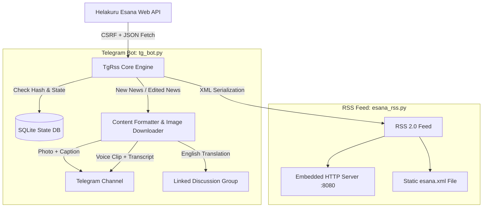

# TgRss — Helakuru Esana Telegram News Bot & RSS Service

[](https://www.python.org/)
[](https://opensource.org/licenses/MIT)
[]()

A lightweight, zero-dependency Python service that bridges live breaking news from [Helakuru Esana](https://www.helakuru.lk/esana) to Telegram channels and standard RSS 2.0 readers.

---

## Table of Contents

- [Features](#features)
- [Architecture & Workflow](#architecture--workflow)
- [Requirements](#requirements)
- [Installation](#installation)
- [Configuration](#configuration)
- [Telegram Bot (`tg_bot.py`)](#telegram-bot-tg_botpy)
  - [Command-line Options](#command-line-options)
  - [Dry-Run Mode](#dry-run-mode)
- [RSS Generator & Server (`esana_rss.py`)](#rss-generator--server-esana_rsspy)
  - [CLI Export](#cli-export)
  - [Live HTTP Server](#live-http-server)
- [Running as a Systemd Service](#running-as-a-systemd-service)
- [Category Reference](#category-reference)
- [License & Disclaimer](#license--disclaimer)

---

## Features

### 📢 Telegram Channel Broadcasting (`tg_bot.py`)
- **Zero External Dependencies**: Powered purely by Python 3 standard library (`urllib`, `sqlite3`, `html`, etc.).
- **Rich Media & Formatting**: Sends news posts with cover photos, headline formatting, category hashtags, and links.
- **Smart Caption Splitting**: Automatically handles Telegram's 1024-character caption limit by sending continuation text when articles exceed caption boundaries.
- **Multi-Image Support**: Detects and posts secondary article images as grouped media albums.
- **Voice News & Audio Clips**: Extracts audio for Voice category news, optionally converts to native OGG Opus with waveforms via `ffmpeg`, and outputs timestamped speaker/transcript markers.
- **Bilingual Discussion Comments**: Automatically posts the English translation and cover photo into the channel's linked Discussion group thread for every post.
- **Edit & Update Detection**: Monitors news items for edits or corrections on Esana and updates existing Telegram messages, captions, and comments dynamically.
- **Persistent State Tracking**: SQLite-backed state store prevents duplicates and survives restarts.

### 📰 RSS 2.0 Generator & Live Server (`esana_rss.py`)
- **Standard RSS 2.0**: Compatible with modern RSS feed readers (Feedly, Inoreader, NetNewsWire, Miniflux, etc.).
- **Live HTTP Server**: Built-in HTTP daemon (`--serve`) that dynamically serves live news XML with custom query parameters (`?lang=en&category=2`).
- **File Export**: Direct export to `.xml` file or standard output for integration with other automation pipelines.
- **Audio Enclosures**: Embeds voice news audio URLs in standard `<enclosure>` tags for podcast and audio-capable RSS readers.

---

## Architecture & Workflow



---

## Requirements

- **Python 3.10+** (Python standard library only; no `pip install` required!)
- **`ffmpeg`** *(Optional)*: Needed only if you want voice news clips converted to native Telegram voice notes (`.ogg` Opus) with animated waveforms. If `ffmpeg` is absent, audio is sent directly.

```bash
# Optional: Install ffmpeg for voice waveform support (Ubuntu / Debian)
sudo apt update && sudo apt install -y ffmpeg
```

---

## Installation

1. **Clone the repository**:
   ```bash
   git clone https://github.com/tharushatheekshana/TgRss.git
   cd TgRss
   ```

2. **Set up your environment file**:
   ```bash
   cp .env.example .env
   ```

3. **Configure your credentials** in `.env`:
   ```bash
   nano .env
   ```

---

## Configuration

Settings can be specified in `.env` or passed via command-line arguments.

| Variable | Description | Default | Example |
| :--- | :--- | :--- | :--- |
| `TG_BOT_TOKEN` | Telegram Bot token from [@BotFather](https://t.me/BotFather) | *Required* | `123456789:ABCDEF_token` |
| `TG_CHAT_ID` | Target Channel username or numeric Chat ID | *Required* | `@HelakuruEsanaNews` or `-1001234567890` |
| `ESANA_LANG` | Primary broadcast language (`si` or `en`) | `si` | `si` |
| `ESANA_CATEGORY` | Category ID to track (`1` = All) | `1` | `1` |
| `POLL_INTERVAL` | Polling frequency in seconds | `30` | `30` |
| `INITIAL_POST_LIMIT` | Max latest news to post on very first run | `1` | `1` |

> [!NOTE]
> For discussion group English comments to function, ensure your Telegram bot is added as an administrator to both your public channel and its linked discussion group.

---

## Telegram Bot (`tg_bot.py`)

### Command-line Options

```bash
python3 tg_bot.py [OPTIONS]
```

| Option | Flag | Description |
| :--- | :--- | :--- |
| `--token` | `TOKEN` | Telegram Bot Token (overrides `TG_BOT_TOKEN`) |
| `--chat-id` | `CHAT_ID` | Telegram Channel / Chat ID (overrides `TG_CHAT_ID`) |
| `--lang` | `{si,en}` | Post language (`si` for Sinhala, `en` for English) |
| `--category` | `INT` | Esana category ID (default: `1` for All) |
| `--interval` | `SECONDS` | Polling interval in seconds (default: `30`) |
| `--initial-limit`| `INT` | Number of recent items to post on initial startup (default: `1`) |
| `--db` | `PATH` | Custom path to SQLite state database |
| `--once` | | Perform a single poll cycle and exit immediately |
| `--dry-run` | | Preview formatted messages without sending to Telegram or modifying database |

### Dry-Run Mode

Test your configuration and inspect generated Telegram captions without publishing anything:

```bash
python3 tg_bot.py --dry-run --once
```

---

## RSS Generator & Server (`esana_rss.py`)

### CLI Export

Generate an RSS XML file or write to stdout:

```bash
# Save Sinhala RSS to a file
python3 esana_rss.py -o esana.xml -l si

# Save English Incidents RSS to a file
python3 esana_rss.py -o incidents_en.xml -l en -c 2

# Output directly to stdout
python3 esana_rss.py -l si
```

### Live HTTP Server

Run an embedded, lightweight HTTP server to serve dynamic RSS feeds:

```bash
python3 esana_rss.py --serve --host 0.0.0.0 --port 8080
```

Subscribe to the feed in your RSS reader using query parameters:
- Default feed: `http://localhost:8080/`
- English feed: `http://localhost:8080/?lang=en`
- Sinhala Voice News: `http://localhost:8080/?lang=si&category=3`
- Incidents: `http://localhost:8080/?category=2`

---

## Running as a Systemd Service

To keep the Telegram bot running continuously in the background on a Linux server:

1. **Verify paths in `tgrss.service`**:
   Make sure the `WorkingDirectory` and `ExecStart` paths point to your actual installation path.
   ```ini
   [Unit]
   Description=Helakuru Esana Telegram News Bot (TgRss)
   After=network-online.target
   Wants=network-online.target

   [Service]
   Type=simple
   WorkingDirectory=/home/tharusha/Documents/TgRss
   ExecStart=/usr/bin/python3 /home/tharusha/Documents/TgRss/tg_bot.py
   Restart=always
   RestartSec=15
   Environment=PYTHONUNBUFFERED=1

   [Install]
   WantedBy=default.target
   ```

2. **Install and activate the service**:
   ```bash
   sudo cp tgrss.service /etc/systemd/system/
   sudo systemctl daemon-reload
   sudo systemctl enable --now tgrss
   ```

3. **Check status and logs**:
   ```bash
   sudo systemctl status tgrss
   journalctl -u tgrss -f
   ```

---

## Category Reference

| ID | Category Name (English) | Category Name (Sinhala) | Hashtag (Sinhala) | Hashtag (English) |
| :---: | :--- | :--- | :--- | :--- |
| **1** | All News | සියලු පුවත් | *(None)* | *(None)* |
| **2** | Incidents | සිද්ධි | `#සිද්ධි` | `#Incidents` |
| **3** | Voice | හඬපට | `#හඬපට` | `#Voice` |
| **4** | Announcements | නිවේදන | `#නිවේදන` | `#Announcements` |
| **5** | Statements | ප්‍රකාශ | `#ප්‍රකාශ` | `#Statements` |

---

## License & Disclaimer

This project is open-source software licensed under the [MIT License](LICENSE).

> [!IMPORTANT]
> **Disclaimer**: This is an independent, community-driven project and is not officially affiliated with, authorized, maintained, or endorsed by Helakuru or Bhasha Lanka (Pvt) Ltd. All news content and trademarks belong to their respective copyright holders.
